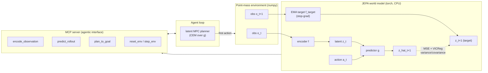
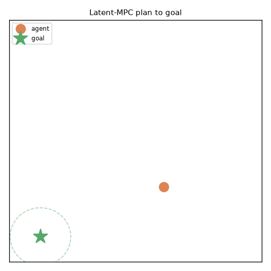
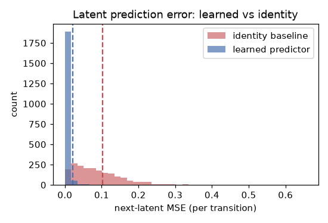
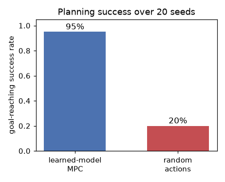

# Oneiros

[](https://github.com/mal0ware/Oneiros/actions/workflows/ci.yml)

**Status:** complete research artifact with verified results. v0.2 adds
image-based perception, backed by the four pixel gates below; v0.1 had listed it
as the next step. The V-JEPA 2 scale-up is still future work because it needs a
GPU and pretrained weights.

**A JEPA-style latent world model that an agent calls over MCP to plan.**

Oneiros is a small, CPU-only research artifact that combines agentic systems
with world models. It trains a Joint Embedding Predictive Architecture (JEPA)
world model on a 2D point-mass environment, then exposes that model as a set of
[Model Context Protocol](https://modelcontextprotocol.io) tools. Agent tools are
usually hand-written functions that an LLM calls. Here the tool is the learned
predictive world model: the agent encodes observations into latents, rolls the
latent dynamics forward, and runs model-predictive control entirely in latent
space.

## Why predict in latent space

A JEPA predicts the future in a learned latent space, not in pixels or tokens.
Given an observation `o_t` and an action `a_t`, it learns an encoder `f` and a
predictor `g` such that `g(f(o_t), a_t)` matches `f(o_{t+1})`. There is no
decoder and no pixel-reconstruction loss. A reconstruction loss spends capacity
on detail that is perceptually salient but irrelevant to control (texture,
lighting, background), while a latent predictor can discard anything that does
not help it anticipate the future. The price is a known failure mode: latent
prediction can collapse to a constant, with every observation mapped to the
same point so that prediction is trivially perfect. Oneiros prevents collapse
with an EMA target encoder, stop-gradients, and a VICReg-style variance and
covariance penalty, then plans with the resulting latent dynamics.

## Architecture



The agent never sees the environment's dynamics. It calls `plan_to_goal`, which
encodes the current and goal observations, searches action sequences by rolling
the predictor `g` forward `H` steps in latent space (cross-entropy method),
scores each candidate by predicted-latent distance to the goal, and returns the
first action. The planner replans every step (receding-horizon MPC).

## Verified results

The numbers below come from one run on my machine (CPU only, seed 0). Train
with `python -m oneiros.train` and reproduce the diagnostics with
`python -m oneiros.demo_agent`.

| Honesty gate | Metric | Result |
|---|---|---|
| (a) Predictor beats no-op baseline | next-latent MSE vs identity baseline | 0.0185 vs 0.1076 (ratio 0.17, ~5.8x better) |
| (b) Latent not collapsed | per-dim latent std (mean / min) | 1.04 / 1.00 (threshold 0.1) |
| (c) MPC beats random | goal-reaching success over 20 seeds | MPC 95% vs random 15-20% |

Training takes about 21 seconds for 4000 steps. The checkpoint
(`oneiros/checkpoint.pt`, ~240 KB) is committed so the demo, MCP server, and
planning tests run without retraining.

### Pixel gates (v0.2): image-based perception

In v0.1 the image encoder could not beat the identity baseline. The diagnosis
had two parts, and v0.2 fixes each one:

1. Consecutive frames were nearly identical. The blob moves about a pixel per
   step, so "predict no change" was already an excellent predictor. Fix: the
   swift environment preset (`PointMassConfig.swift()`), with a larger `dt` and
   acceleration so the agent moves several pixels per frame, plus
   speed-proportional drag so the dynamics are non-linear.
2. A single frame hides velocity. The dynamics are second-order, so no
   single-frame predictor can recover the next state, and the convolutional
   encoder exploited this by temporal smoothing: it mapped consecutive frames
   to nearly identical latents. The dataset-wide variance penalty does not
   forbid that, and more training made it worse (MSE ratio from 0.89 to 0.94).
   Fixes: two-frame stacking, which makes velocity observable from pixels (the
   same reason pixel world models from DQN to V-JEPA take clips instead of
   single frames), and a delta-variance penalty, a VICReg-style hinge on the
   std of `z_{t+1} - z_t` that rules out the temporal collapse.

Results for the committed `checkpoint_image.pt` (~735 KB) on heldout data,
enforced as tests in `tests/test_gates_image.py`:

| Pixel gate | Metric | Result |
|---|---|---|
| (d) Image predictor beats no-op | heldout next-latent MSE ratio vs identity | 0.11 (vector model: 0.17) |
| (e) Latent not collapsed, incl. temporally | per-dim std / one-step delta MSE | 1.10 / 1.08 (pre-fix delta was 0.012) |
| (f) Pixel MPC beats random | goal-reach rate + median steps over 20 seeds | 20/20, median 9.5 steps vs 27.5 random |
| (g) Imagination useful at horizon | compounded H-step rollout MSE ratio | 0.45 at H=4, 0.86 at H=12 |

One negative result is measured but deliberately left out of the gates: a
privileged linear-dynamics MPC that reads the true 4D state still reaches the
goal about twice as fast as the pixel planner (median ~5 vs ~9.5 steps).
Planning from pixels has not caught up with planning from privileged state, and
gate (g) shows open-loop imagination degrading by horizon 12, which is why the
planner replans every step. The baselines are in `oneiros/baselines.py`; to
reproduce, use the image-training command under [Run](#run).



The agent drives the point-mass to the goal (green star) using only the
world-model planning interface.

| Latent prediction error | Planning success |
|---|---|
|  |  |

## Scope and limits

Oneiros is an end-to-end demonstration that (1) a non-trivial latent dynamics
model can be learned without collapse and without reconstruction, and (2)
planning in that latent space solves a control task far better than chance,
all behind an agentic tool interface.

It does not show any of this at scale. The environments are toy 2D point-masses
and the models are tiny (a few hundred KB). The default committed model uses a
vector-state observation on the original environment. The committed image
model (v0.2, `checkpoint_image.pt`) sees stacked 32x32 frames on the swift
environment and clears its own four gates above. The scale-up is still future
work: a frozen pretrained perception encoder such as
[V-JEPA 2](https://ai.meta.com/vjepa/) with a learned latent dynamics head on
top, which is the recipe this toy mirrors. That step needs a GPU and pretrained
weights, and this artifact is CPU-only on purpose.

## Install

Requires Python 3.12. A project-local virtual environment is recommended.

```bash
python -m venv .venv
# Windows: .venv\Scripts\activate    |    Unix: source .venv/bin/activate
pip install torch --index-url https://download.pytorch.org/whl/cpu
pip install -e ".[dev]"
```

`torch` is installed from the CPU wheel index, so no GPU is needed or used.

## Run

```bash
# Train the JEPA world model (writes oneiros/checkpoint.pt). ~21s on CPU.
python -m oneiros.train --obs-mode vector --steps 4000

# Train the image world model on the swift environment (~3 min on CPU).
# This is the exact recipe of the committed checkpoint: two-frame stacking,
# the delta-variance penalty, and an explicit --checkpoint so the vector
# model's default path is not clobbered.
python -m oneiros.train --obs-mode image --env swift --steps 6000 \
    --frame-stack 2 --delta-var-weight 25 --checkpoint oneiros/checkpoint_image.pt

# Run the scripted agent: drive to the goal via latent MPC, write the GIF +
# diagnostic plots to assets/.
python -m oneiros.demo_agent --seed 0 --k 20

# Tests, including the seven honesty gates (uses the committed checkpoints).
pytest -q

# Lint.
ruff check oneiros tests
```

## MCP server

The world model is exposed over MCP as a stdio server:

```bash
# vector model (default)
python -m oneiros.mcp_server

# the committed image model: stacked-frame observations, swift environment
python -m oneiros.mcp_server --obs-mode image

# any other checkpoint
python -m oneiros.mcp_server --checkpoint /path/to/checkpoint.pt
```

`--obs-mode` selects which committed world model the server exposes. The
environment tools serve observations in the loaded model's format (6D vectors,
or the stacked rendered frames the image model trains on), and `reset_env`
returns a ready-made `goal_observation` for the planning tools. The served
environment always uses the configuration the checkpoint was trained on (the
swift preset for the image model).

Tools:

| Tool | Purpose |
|---|---|
| `encode_observation` | observation -> latent `z` (the trained JEPA encoder) |
| `predict_rollout` | roll latent dynamics `g` forward over an action sequence |
| `plan_to_goal` | latent-space MPC; returns the next action toward a goal |
| `plan_trajectory` | full best action sequence + the imagined latent path |
| `model_info` | loaded model's obs mode, dims, and honesty-gate metrics |
| `reset_env` / `step_env` | drive the point-mass environment; a `session` id keeps concurrent agent sessions independent |

To register the server with Claude Desktop, add this to
`claude_desktop_config.json` (use absolute paths for your checkout):

```json
{
  "mcpServers": {
    "oneiros": {
      "command": "C:/path/to/Oneiros/.venv/Scripts/python.exe",
      "args": ["-m", "oneiros.mcp_server"],
      "cwd": "C:/path/to/Oneiros"
    }
  }
}
```

On Unix the `command` is `.venv/bin/python`. Append `"--obs-mode", "image"`
to `args` to serve the committed image world model instead of the vector one.

## Repository layout

```
oneiros/
  env.py          # deterministic 2D point-mass environment (numpy)
  model.py        # JEPA encoder + predictor + VICReg regularizers
  data.py         # random-policy rollout replay buffer
  train.py        # JEPA training loop, evaluation, checkpoint I/O
  planner.py      # latent-space MPC (CEM / random shooting)
  baselines.py    # pixel episode runners + privileged linear-MPC baseline
  mcp_server.py   # MCP tools exposing the world model
  demo_agent.py   # scripted agent + diagnostics (GIF, plots)
  checkpoint.pt        # committed vector model (~240 KB)
  checkpoint_image.pt  # committed image model, swift env (~735 KB)
tests/            # determinism, shapes, and the seven honesty gates
assets/           # generated GIF and diagnostic figures
```

See [SYNERGY.md](SYNERGY.md) for how the same latent-dynamics idea connects to
regime-aware modeling in time series.

## License

MIT. See [LICENSE](LICENSE).
