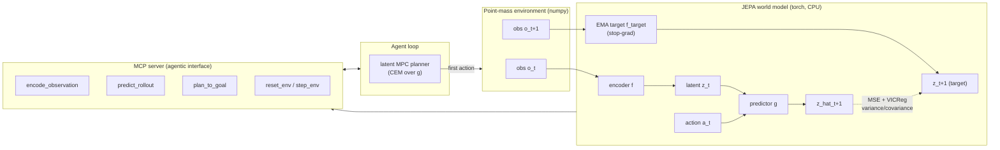

# Oneiros

**A JEPA-style latent world model that an agent calls as a tool — over MCP — to plan.**

Oneiros is a small, CPU-only research artifact at the intersection of *agentic
systems* and *world models*. It trains a Joint Embedding Predictive Architecture
(JEPA) world model on a 2D point-mass environment, then exposes that model as a
set of [Model Context Protocol](https://modelcontextprotocol.io) tools. An agent
plans by **calling the learned predictive world model as a tool** — encoding
observations into latents, rolling latent dynamics forward, and running
model-predictive control entirely in latent space — rather than the usual
pattern of an LLM calling hand-written functions.

## Why predict in latent space

A JEPA predicts the future in a **learned latent space**, not in pixels or
tokens. Given an observation `o_t` and an action `a_t`, it learns an encoder
`f` and a predictor `g` such that `g(f(o_t), a_t)` matches `f(o_{t+1})` — there
is no decoder and no pixel-reconstruction loss. This matters because
reconstruction wastes capacity modeling perceptually salient but
control-irrelevant detail (texture, lighting, background), while a latent
predictor is free to discard everything that does not help it anticipate the
future. The cost is a well-known failure mode: latent prediction can collapse to
a constant (every observation maps to the same point, making prediction
trivially perfect). Oneiros defeats collapse with an EMA target encoder,
stop-gradients, and a VICReg-style variance + covariance penalty, and then uses
the resulting latent dynamics for planning.

## Architecture



The agent never sees the environment's dynamics. It calls `plan_to_goal`, which
encodes the current and goal observations, searches action sequences by rolling
the predictor `g` forward `H` steps in latent space (cross-entropy method),
scores each candidate by predicted-latent distance to the goal, and returns the
first action. The planner replans every step (receding-horizon MPC).

## Verified results

Numbers below are from an actual run on this machine (CPU only, seed 0). Train
with `python -m oneiros.train` and reproduce the diagnostics with
`python -m oneiros.demo_agent`.

| Honesty gate | Metric | Result |
|---|---|---|
| **(a) Predictor beats no-op baseline** | next-latent MSE vs identity baseline | **0.0185 vs 0.1076** (ratio 0.17 — ~5.8x better) |
| **(b) Latent not collapsed** | per-dim latent std (mean / min) | **1.04 / 1.00** (threshold 0.1) |
| **(c) MPC beats random** | goal-reaching success over 20 seeds | **MPC 95% vs random 15-20%** |

Training takes about 21 seconds for 4000 steps. The checkpoint
(`oneiros/checkpoint.pt`, ~240 KB) is committed so the demo, MCP server, and
planning tests run without retraining.


The agent drives the point-mass to the goal (green star) using only the
world-model planning interface.

| Latent prediction error | Planning success |
|---|---|
|  |  |

## What this is — and isn't

This **is** a genuine, end-to-end demonstration that (1) a non-trivial latent
dynamics model can be learned without collapse and without reconstruction, and
(2) planning *in that latent space* solves a control task far better than chance,
all behind an agentic tool interface.

It **is not** at scale. The environment is a toy 2D point-mass, the models are
tiny (a few hundred KB), and the latent dynamics are nearly linear. The default,
committed model uses a **vector-state observation** (the 4D state plus the 2D
goal), with the encoder still learning a latent representation. An image-based
encoder (the CNN in `oneiros/model.py`, `--obs-mode image`) trains without
collapse but, on this environment, does **not** beat the identity baseline in
latent prediction: consecutive 32x32 frames are nearly identical because the
blob moves only slightly per step, so "predict no change" is already an
excellent predictor and there is no margin to demonstrate learned dynamics.
Rather than overstate the result, the vector-observation model is the default;
**image-based perception is the documented next step**, and the honest scale-up
path is a frozen pretrained perception encoder such as
[V-JEPA 2](https://ai.meta.com/vjepa/) with a learned latent dynamics head on
top, exactly the recipe this toy mirrors.

## Install

Requires Python 3.12. A project-local virtual environment is recommended.

```bash
python -m venv .venv
# Windows: .venv\Scripts\activate    |    Unix: source .venv/bin/activate
pip install torch --index-url https://download.pytorch.org/whl/cpu
pip install numpy "mcp[cli]" pillow imageio matplotlib pytest ruff
# or, editable install of the package itself:
pip install -e ".[dev]"
```

`torch` is installed from the CPU wheel index — no GPU is needed or used.

## Run

```bash
# Train the JEPA world model (writes oneiros/checkpoint.pt). ~21s on CPU.
python -m oneiros.train --obs-mode vector --steps 4000

# Run the scripted agent: drive to the goal via latent MPC, write the GIF +
# diagnostic plots to assets/.
python -m oneiros.demo_agent --seed 0 --k 20

# Tests, including the three honesty gates (uses the committed checkpoint).
pytest -q

# Lint.
ruff check oneiros tests
```

## MCP server

The world model is exposed over MCP as a stdio server:

```bash
python -m oneiros.mcp_server
```

Tools:

| Tool | Purpose |
|---|---|
| `encode_observation` | observation -> latent `z` (the trained JEPA encoder) |
| `predict_rollout` | roll latent dynamics `g` forward over an action sequence |
| `plan_to_goal` | latent-space MPC; returns the next action toward a goal |
| `reset_env` / `step_env` | drive the underlying point-mass environment |

To register the server with Claude Desktop, add this to
`claude_desktop_config.json` (use absolute paths for your checkout):

```json
{
  "mcpServers": {
    "oneiros": {
      "command": "C:/path/to/Oneiros/.venv/Scripts/python.exe",
      "args": ["-m", "oneiros.mcp_server"],
      "cwd": "C:/path/to/Oneiros"
    }
  }
}
```

On Unix the `command` is `.venv/bin/python`.

## Repository layout

```
oneiros/
  env.py          # deterministic 2D point-mass environment (numpy)
  model.py        # JEPA encoder + predictor + VICReg regularizers
  data.py         # random-policy rollout replay buffer
  train.py        # JEPA training loop, evaluation, checkpoint I/O
  planner.py      # latent-space MPC (CEM / random shooting)
  mcp_server.py   # MCP tools exposing the world model
  demo_agent.py   # scripted agent + diagnostics (GIF, plots)
  checkpoint.pt   # committed trained model (~240 KB)
tests/            # determinism, shapes, and the three honesty gates
assets/           # generated GIF and diagnostic figures
```

See [SYNERGY.md](SYNERGY.md) for how the same latent-dynamics idea connects to
regime-aware modeling in time series.

## License

MIT — see [LICENSE](LICENSE).
